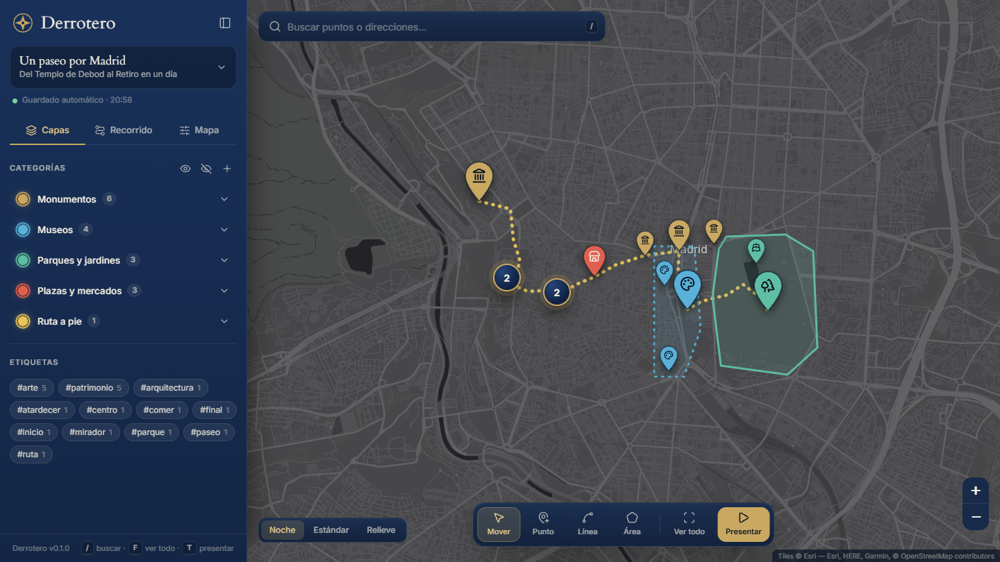
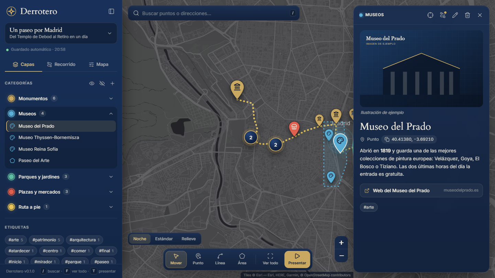
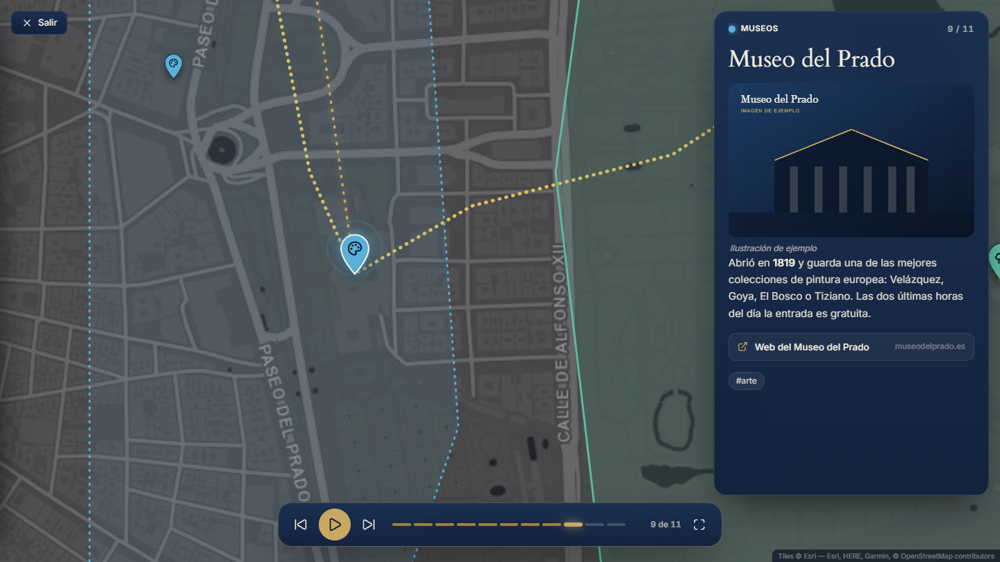
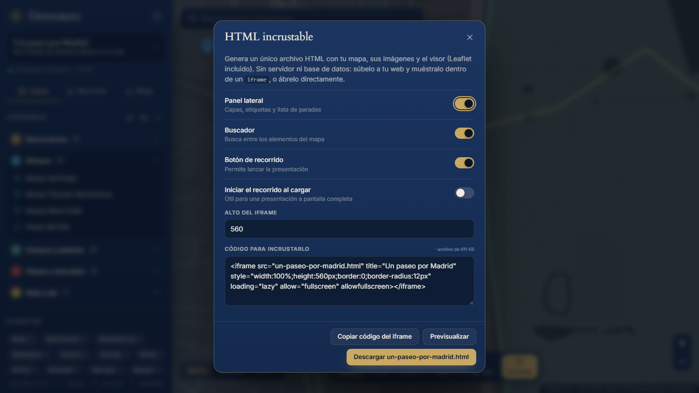

# Derrotero

Mapas interactivos propios, sin cuentas, sin límites y sin pagos. Colocas puntos, trazas líneas y dibujas áreas, les añades imágenes, enlaces y texto, los ordenas por categorías y los enseñas como un recorrido animado. Todo en una página estática: sin servidor ni base de datos.



Sirve para cualquier cosa que se cuente mejor sobre un mapa y parada a parada: una ruta turística, un estudio de ubicación para un negocio, un diario de viaje o una guía de barrio. Al abrirlo por primera vez carga un ejemplo, un paseo a pie por el centro de Madrid, para que veas todo lo que hace.

## Qué puede hacer

- **Puntos, líneas y áreas.** Con icono (80 disponibles), color, tamaño y forma (chincheta o círculo). Las líneas y las áreas se miden en directo (distancia y superficie) y se editan vértice a vértice.
- **Categorías como capas.** Cada categoría tiene su color, se activa y desactiva, y admite el modo «solo esta». Además hay etiquetas para filtrar.
- **Fichas completas.** Título, descripción con formato, varias imágenes (subidas o por enlace), enlaces y etiquetas.
- **Buscador** de elementos del mapa y de direcciones.
- **Agrupación de marcas** cuando hay muchas juntas, con radio ajustable.
- **Modo recorrido.** Vuela de parada en parada con un panel lateral, ruta animada, avance automático y pantalla completa. Pensado para presentar.
- **Exportación como HTML incrustable.** Un único archivo con el mapa, las imágenes y el visor, listo para ponerlo en tu web dentro de un `iframe`.
- **Importar y exportar** el JSON propio (copia completa con imágenes) y GeoJSON. También se puede arrastrar un archivo al mapa.
- **Guardado automático** en el navegador, con varios mapas.
- **Tres mapas base:** Noche, Estándar y Relieve.

| Ficha de un punto | Modo recorrido |
|---|---|
|  |  |

## Cómo usarlo

Necesitas un navegador moderno y conexión a internet (los mosaicos del mapa se cargan en línea). No hay nada que instalar.

**Opción rápida:** abre `index.html` con el navegador.

**Opción recomendada:** sírvelo por HTTP.

```bash
python3 -m http.server 8080
```

y abre `http://localhost:8080`. Con esta opción el buscador de direcciones funciona mejor, porque el servicio que usa puede rechazar peticiones que no traen `Referer`, que es lo que ocurre al abrir un archivo directamente.

Usa siempre la misma forma de abrirlo. Los mapas se guardan en el almacenamiento del navegador, que es distinto para `file://`, para cada dirección y para cada puerto.

### Dónde se guardan tus datos

En el navegador (IndexedDB), no en la carpeta del proyecto. Las imágenes que subes se reducen a 1280 px y se guardan dentro del propio mapa. Por eso:

- Borrar los datos del sitio, usar una ventana privada o abrir la herramienta en otro navegador u ordenador te mostrará los mapas vacíos.
- **Haz copias de seguridad.** Pestaña **Mapa → Exportar → JSON** descarga una copia completa con imágenes. Para recuperarla, arrastra el archivo al mapa.

### Atajos

`/` buscar · `V` mover · `P` punto · `L` línea · `A` área · `F` ver todo · `T` presentar · `Supr` borrar · `Esc` cancelar

En el recorrido: `←` `→` cambian de parada, `Espacio` activa el avance automático, `F` pantalla completa, `Esc` sale.

## Exportar para incrustar en tu web

Pestaña **Mapa → Exportar → HTML incrustable**. Eliges qué muestra (panel, buscador, botón de recorrido, inicio automático) y la altura del `iframe`. Descarga el archivo, súbelo a tu hosting y pega el código que te genera:

```html
<iframe src="/mapas/mi-mapa.html" style="width:100%;height:560px;border:0" allowfullscreen loading="lazy"></iframe>
```



El archivo es independiente: lleva dentro el visor, Leaflet, las fuentes y tus imágenes. Pesa lo que pesen tus imágenes más unos 590 KB.

## Desplegar en un servidor

Es una web estática, así que sirve cualquier hosting.

**GitHub Pages:** en el repositorio, *Settings → Pages*, origen *Deploy from a branch*, rama `main` y carpeta `/ (root)`. En un par de minutos queda publicado en `https://<usuario>.github.io/<repositorio>/`.

**Coolify (Hetzner u otro VPS):**

1. Sube el repositorio a GitHub.
2. En Coolify: *New resource → Public/Private Repository* y elige **Dockerfile** como build pack. El repositorio ya trae `Dockerfile` y `nginx.conf`.
3. Puerto `80`. Asigna el dominio y activa HTTPS.

Sin Docker: build pack *Static*, directorio de publicación `/` y sin comando de build.

**Docker a mano:**

```bash
docker build -t derrotero .
docker run -p 8080:80 derrotero
```

## Estructura

```
index.html            Aplicación
css/app.css           Estilos
js/
  util.js             Utilidades, toasts y nombre de la aplicación
  store.js            Modelo de datos y guardado automático (IndexedDB)
  map.js              Mapa Leaflet, mapas base, marcas y vuelos
  draw.js             Dibujo y medición de líneas y áreas
  editor.js           Fichas de edición
  ui.js               Panel lateral, categorías y menús
  search.js           Buscador de elementos y direcciones
  tour.js             Modo recorrido
  io.js               Importar y exportar (JSON, GeoJSON, HTML incrustable)
  demo.js             Mapa de ejemplo
  icons-data.js       Iconos (generado desde Lucide)
  viewer-template.js  Visor de la exportación (generado)
vendor/               Leaflet, markercluster, Lucide y fuentes, con sus licencias
tools/                Scripts para regenerar las piezas generadas
docs/                 Capturas de este README
```

### Regenerar las piezas generadas

- `node tools/build-viewer-template.js` regenera `js/viewer-template.js`. Hay que ejecutarlo cada vez que cambies código de `js/` o `css/`; si no, el HTML incrustable seguirá usando la versión anterior.
- `node tools/gen-icons.js` regenera `js/icons-data.js` desde Lucide. Necesita `npm i lucide-static` y, si lo tienes en otra ruta, la variable `LUCIDE_ICONS`.

### Cambiar el nombre

«Derrotero» es el nombre de trabajo. Se define en `js/util.js` (`D.APP_NAME`) y se muestra en los elementos con `data-app-name` de `index.html`. El título de la pestaña lo coge de ahí. Quedan por cambiar a mano el `<title>` inicial de `index.html`, la clave de almacenamiento (`derrotero`, en `js/store.js`) y el nombre de imagen de Docker.

## Formato de datos

El JSON propio es `{ format: 'derrotero', version: 1, meta, view, settings, categories, items, tour }`. Los elementos son `point`, `line` o `area`.

El GeoJSON exportado guarda el estilo en las propiedades, de modo que se abre en herramientas como geojson.io, y añade un bloque `derrotero` para recuperar categorías y recorrido al volver a importarlo.

## Limitaciones conocidas

- Los datos viven en un navegador. No hay sincronización entre dispositivos ni edición entre varias personas.
- Hace falta conexión para ver el mapa base. No hay mapas sin conexión.
- Las imágenes se guardan dentro del mapa. Con muchas imágenes el JSON y el HTML exportado crecen; exporta copias con frecuencia.
- El buscador de direcciones usa Nominatim, que limita el uso intensivo. Solo consulta al pulsar Intro.
- El mapa de ejemplo («Un paseo por Madrid») tiene ubicaciones y trazados aproximados e imágenes ilustrativas. El botón **Nuevo mapa vacío** de la pestaña Mapa empieza de cero, y **Cargar el ejemplo** lo recupera.

## Hoja de ruta

- Importar KML y CSV con coordenadas.
- Subida de imágenes opcional a una carpeta propia en lugar de incrustarlas.
- Elegir la capa de mapa base por mapa y añadir más proveedores sin clave.
- Exportar el recorrido como vídeo o como presentación.

## Licencia y créditos

Derrotero se publica con licencia [MIT](LICENSE). Puedes usarlo, copiarlo, modificarlo y distribuirlo, también con fines comerciales.

Componentes de terceros, cada uno con su licencia en `vendor/`:

| Componente | Uso | Licencia |
|---|---|---|
| [Leaflet](https://leafletjs.com) 1.9.4 | Motor del mapa | BSD-2-Clause |
| [Leaflet.markercluster](https://github.com/Leaflet/Leaflet.markercluster) | Agrupación de marcas | MIT |
| [Lucide](https://lucide.dev) | Iconos | ISC |
| [Cardo](https://fonts.google.com/specimen/Cardo) e [Inter](https://rsms.me/inter/) | Tipografías | SIL OFL 1.1 |

Mapas base: teselas de [Esri](https://www.esri.com) (ArcGIS Online: Canvas World Dark Gray, World Street Map y World Topo Map), con datos de colaboradores de [OpenStreetMap](https://www.openstreetmap.org/copyright). No necesitan clave, pero tienen sus propias condiciones de uso: si publicas un mapa en un sitio comercial o con mucho tráfico, revísalas y, si hace falta, cambia el proveedor en `js/map.js`. Búsqueda de direcciones: [Nominatim](https://nominatim.org) de OpenStreetMap.
